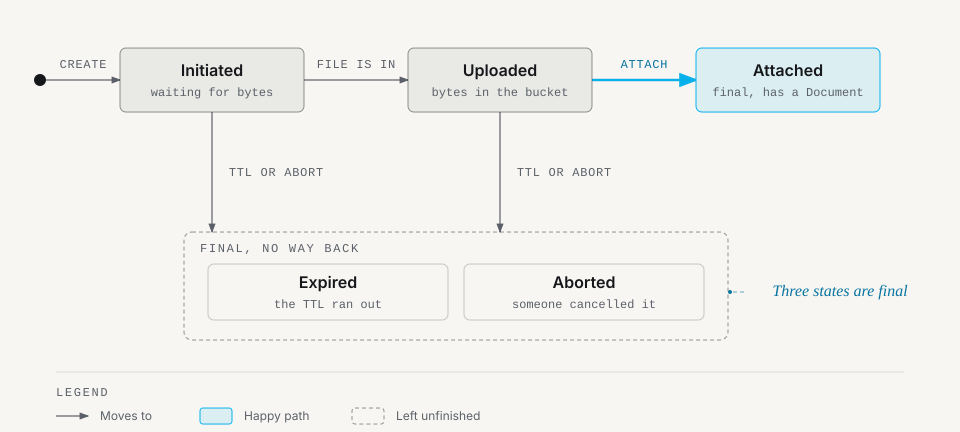

# Concepts

## Document types

A `DocumentType` defines rules for an upload category:
- `code` and `name`: unique identifier and label.
- `max_size_mb`: maximum allowed file size.
- `allowed_mimes`: list of allowed MIME types evaluated from file bytes.
- `allowed_extensions`: optional allowed file extensions.
- `disk`: storage disk defined in `config/filesystems.php`.
- `path_prefix`: storage directory prefix for objects.
- `requires_versioning`: whether replacing a file creates a new version or replaces in place.
- `allows_multiple`: whether an owner can hold multiple independent slots of this type.
- `versions_kept` and `versions_retain_days`: automatic retention thresholds.
- `on_delete_latest`: policy when the latest version is soft-deleted (`promote`, `none`, or `block`).

## Upload sessions

All uploads run on server-managed `UploadSession` records. The client holds only the session ID. The server generates storage keys and keeps provider upload IDs private. An upload session progresses through five states: `initiated`, `uploaded`, `attached`, `expired`, and `aborted`.

  <picture>
    <source media="(prefers-color-scheme: dark)" srcset="images/session-states-dark.svg">
    
  </picture>

## Attach

Once raw bytes reach storage and pass initial size and MIME checks, the session status is `uploaded`. Attaching the session to an owner model creates the `Document` record. Attach happens via `POST /documents/attach` over HTTP or through `DocumentService::attachStorageFile()` in PHP.

## Versions and slots

- `allows_multiple = false` (single slot): the owner has one document slot of this type. Uploading a replacement targets that slot.
- `allows_multiple = true` (multi-slot): the owner can hold multiple independent document groups. Each group has its own `document_group_id`.
- `requires_versioning = true`: subsequent uploads to the same slot increment the version number (`version = 1, 2, 3...`) and update the latest pointer.
- `requires_versioning = false`: a new upload soft-deletes the previous document and starts again at version 1. No history is kept.

## Document statuses

Documents transition through three statuses:
- `committed`: the file passed size, MIME, hash, and virus scanning checks. It is active, ready to serve, and eligible for deduplication.
- `processing`: uploads larger than `documentable.verification.sync_hash_max_bytes` create documents in `processing` status. A queued job computes hashes and runs virus scanners in the background. While `processing`, a document cannot be downloaded or deduplicated against.
- `rejected`: background verification detected a size, MIME, or hash mismatch, or a virus scanner failure. The document cannot be served.

## Glossary

| Term | Meaning |
|---|---|
| Disk | Flysystem disk name in `config/filesystems.php`. Requires an S3-compatible service, such as AWS S3, Cloudflare R2 or MinIO. |
| DocumentType | A named category of upload with rules: maximum size, allowed formats, disk, prefix, and retention policies. |
| Documentable | The Eloquent model that owns documents (`Invoice`, `User`, `Project`). Uses the `Documentable` trait. |
| Dedup (deduplication) | Storing identical file contents once by SHA-256 hash and sharing the `StorageFile` across documents within the configured scope. |
| Versioning | Preserving past file versions for a slot when a new file is uploaded. |
| Presigned URL | A short-lived URL that lets a client send bytes directly to storage without routing files through your Laravel server. |
| Multipart upload | Chunked upload for large files. The file is split into parts uploaded independently to the storage provider. |
| ETag | A checksum returned by storage for uploaded parts, used during multipart completion. |
| Morph type / `documentable_type` | Eloquent morph class or morph map alias for the model owning the document. |
| Authorizer | Implementation of `AuthorizesDocumentAccess` deciding upload, attach, view, and delete permissions. |
