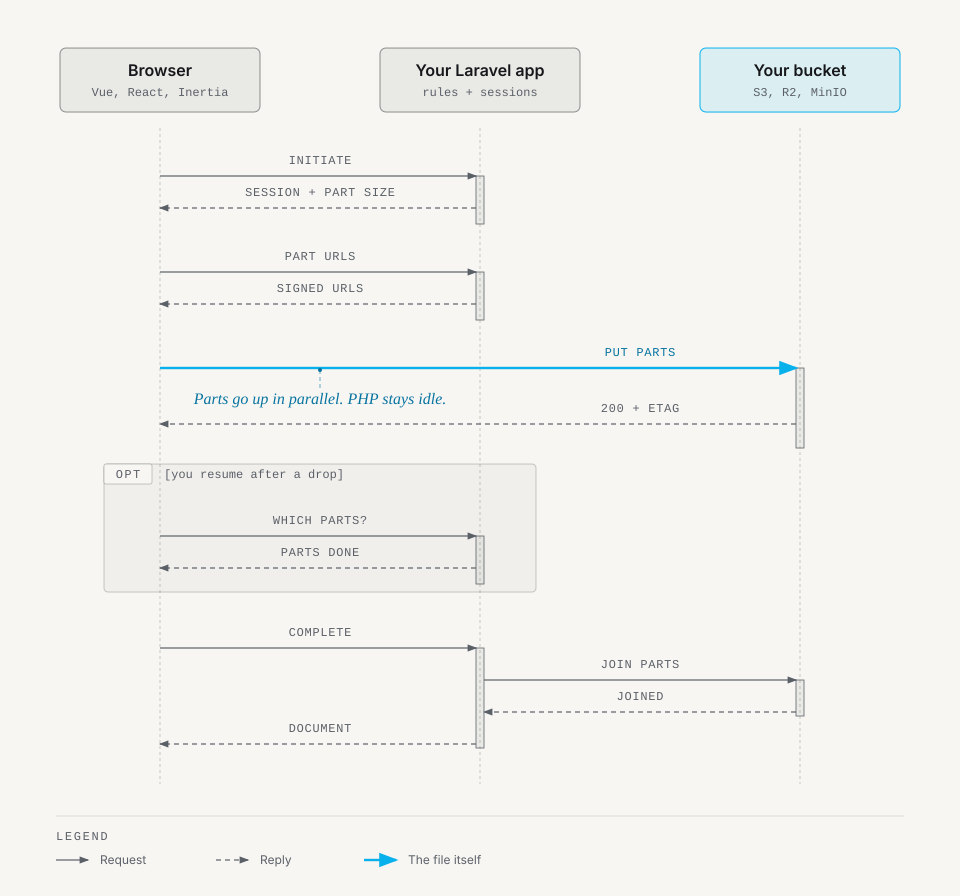
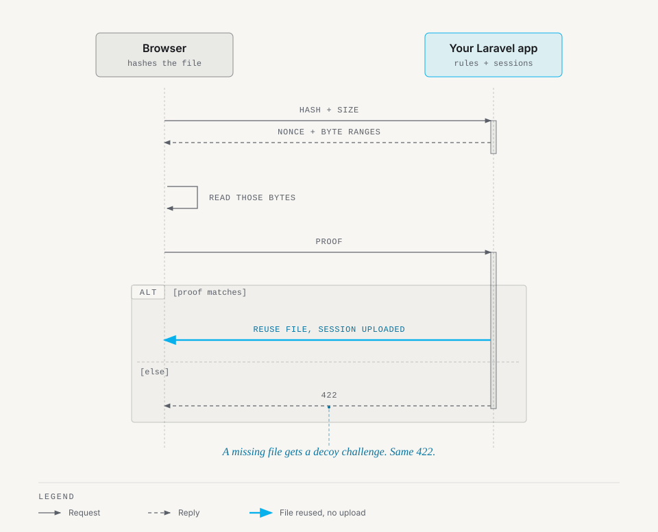

# Upload flows and the client

The package provides routes under `/documents` (`config('documentable.load_routes')`, default `true`). Set `config('documentable.route_prefix')` to mount them elsewhere, for example when your app already has routes of its own under `/documents`. The client sends file bytes straight to storage, so they never pass through your application server.

Routes mount under `config('documentable.middleware')` (default `['api']`). For session-based monoliths (Inertia, Livewire, Blade), configure `['web', 'auth']` so `$request->user()` is populated.

## Listing document types

```http
GET /documents/types
```

Returns active document types for which `canInitiateUpload` returns `true`.

## Client configuration

Before initiating an upload, client uploaders can read server limits and concurrency settings:

```http
GET /documents/config
```

Response (`200 OK`):

```json
{
  "threshold_bytes": 10485760,
  "min_part_size": 5242880,
  "max_parts": 10000,
  "max_concurrency": 4,
  "retry": {
    "attempts": 3,
    "base_delay_ms": 500,
    "max_delay_ms": 8000
  },
  "sync_hash_max_bytes": 52428800,
  "etag_strategy": "server-authoritative",
  "types": [
    {
      "id": "9c0a1b2c-3d4e-5f6a-7b8c-9d0e1f2a3b4c",
      "code": "passport",
      "name": "Passport",
      "max_bytes": 10485760,
      "allowed_mimes": ["application/pdf"],
      "allowed_extensions": ["pdf"],
      "trust_extension_for_generic_mime": false,
      "allows_multiple": false
    }
  ]
}
```

The response includes:
- `threshold_bytes`: Byte threshold where uploads switch from direct PUT to multipart.
- `min_part_size`: Minimum part size in bytes for multipart uploads (5 MiB).
- `max_parts`: Maximum number of parts allowed by the storage provider (10,000).
- `max_concurrency`: Maximum parallel part uploads configured in `documentable.client.max_concurrency`.
- `retry`: Retry policy for part uploads (`attempts`, `base_delay_ms`, `max_delay_ms`) from `documentable.client.retry`.
- `sync_hash_max_bytes`: Byte threshold above which verification runs asynchronously in the queue.
- `etag_strategy`: ETag completion strategy (`client` or `server-authoritative`).
- `types`: Document types the authenticated user is authorized to upload to, with limits in bytes.

## Upload through your server

`POST /documents` accepts a `multipart/form-data` upload with a `file` field and a `document_type_id`. Add `documentable_type` and `documentable_id` to attach it in the same request. The request answers `201` with the document. Without an owner it answers `201` with an upload session to attach later. Use it when you cannot send files straight to the bucket. The bytes pass through PHP, so `upload_max_filesize` and `post_max_size` apply, and the direct flows below avoid that.

## Small files with presigned PUT

For files below `multipart.threshold_bytes` (default 10MB):

1. Request a presigned URL:
   ```http
   POST /documents/presigned
   Content-Type: application/json

   {
     "document_type_id": "9c0a1b2c-3d4e-5f6a-7b8c-9d0e1f2a3b4c",
     "filename": "invoice.pdf",
     "declared_size": 1048576
   }
   ```
   `declared_size`, `declared_mime` and `declared_hash` are optional. On finalize the server compares `declared_size` and `declared_hash` with the stored object and refuses a mismatch. It records `declared_mime` but ignores it: it decides the type from the file's bytes.
   Response (`200 OK`):
   ```json
   {
     "session_id": "01J9ZK3M8Q4N7V2R6T5B1C3D5E",
     "url": "https://storage.example.com/invoices/...",
     "headers": {},
     "expires_at": "2026-10-31T20:00:00+00:00"
   }
   ```

2. The client sends a `PUT` request with raw file bytes directly to `url`.

3. Finalize the upload:
   ```http
   POST /documents/presigned/finalize
   Content-Type: application/json

   {
     "session_id": "01J9ZK3M8Q4N7V2R6T5B1C3D5E",
     "expected_hash": "a1b2c3d4..."
   }
   ```

4. Attach the upload to an owner:
   ```http
   POST /documents/attach
   Content-Type: application/json

   {
     "session_id": "01J9ZK3M8Q4N7V2R6T5B1C3D5E",
     "documentable_type": "invoice",
     "documentable_id": "42"
   }
   ```
   Response (`201 Created`) returns the new `Document` resource. You can also pass `documentable_type` and `documentable_id` directly to `/finalize` to finalize and attach in one request.

## Large files with multipart uploads

For files at or above `multipart.threshold_bytes`:

<p align="center">
  <picture>
    <source media="(prefers-color-scheme: dark)" srcset="images/multipart-resume-dark.svg">
    
  </picture>
</p>

1. Initiate the multipart session:
   ```http
   POST /documents/multipart/initiate
   Content-Type: application/json

   {
     "document_type_id": "9c0a1b2c-3d4e-5f6a-7b8c-9d0e1f2a3b4c",
     "filename": "archive.zip",
     "declared_size": 104857600
   }
   ```
   Response (`201 Created`) is the upload session. These are the fields to use, and the response carries more:
   ```json
   {
     "id": "01J9ZK3M8Q4N7V2R6T5B1C3D5E",
     "kind": "multipart",
     "part_size": 10485760,
     "status": "initiated",
     "expires_at": "2026-10-31T20:00:00+00:00"
   }
   ```

2. Request presigned upload URLs for part numbers in batches (up to 100 parts per request):
   ```http
   POST /documents/multipart/part-urls
   Content-Type: application/json

   {
     "session_id": "01J9ZK3M8Q4N7V2R6T5B1C3D5E",
     "part_numbers": [1, 2]
   }
   ```
   Response: `{ "urls": { "1": "https://...", "2": "https://..." } }`. The client sends a `PUT` with each part's bytes to its corresponding URL. Under `etag_strategy = client`, save the `ETag` header from each PUT response. Under `server-authoritative`, the server reads parts from storage directly.

3. Complete the upload:
   ```http
   POST /documents/multipart/complete
   Content-Type: application/json

   {
     "session_id": "01J9ZK3M8Q4N7V2R6T5B1C3D5E",
     "expected_hash": "e3b0c44...",
     "parts": [{"PartNumber": 1, "ETag": "\"hash\""}]
   }
   ```

The response is the session in `uploaded` status. If the request also carries `documentable_type` and `documentable_id`, the server attaches in the same call and returns the new `Document` (`201 Created`).

4. Otherwise attach via `POST /documents/attach`.

If an upload fails or the user cancels, call abort:
```http
POST /documents/multipart/abort
Content-Type: application/json

{
  "session_id": "01J9ZK3M8Q4N7V2R6T5B1C3D5E"
}
```

To resume after a network interruption, check session status and uploaded parts. The [browser client](browser-client.md#connection-loss-and-resuming) does this when you pass `resumeSessionId`:
```http
GET /documents/multipart/status?session_id=01J9ZK3M8Q4N7V2R6T5B1C3D5E
GET /documents/multipart/parts?session_id=01J9ZK3M8Q4N7V2R6T5B1C3D5E
```

## Deduplication handshake

To prevent hash oracle attacks when deduplicating files, clients perform a proof-of-possession handshake:

<p align="center">
  <picture>
    <source media="(prefers-color-scheme: dark)" srcset="images/dedup-handshake-dark.svg">
    
  </picture>
</p>

1. Request a challenge:
   ```http
   POST /documents/handshake
   Content-Type: application/json

   {
     "type": "invoice-pdf",
     "hash": "<sha256-hex>",
     "size": 1048576,
     "documentable_type": "invoice",
     "documentable_id": "42"
   }
   ```
   Response (`200 OK`):
   ```json
   {
     "challenge_id": "...",
     "nonce": "...",
     "ranges": [{"offset": 1024, "length": 4096}]
   }
   ```
   If the file does not exist, the server returns a decoy challenge with identical structure to prevent timing and enumeration attacks.

2. Submit proof of possession:
   ```http
   POST /documents/handshake/answer
   Content-Type: application/json

   {
     "challenge_id": "...",
     "proof": "<sha256-of-nonce-and-requested-byte-ranges>",
     "filename": "invoice.pdf"
   }
   ```
   On verification success, the server returns an `UploadSession` in `uploaded` status ready to attach. On failure, HTTP 422 is returned. Three invalid attempts expire the challenge.

   A decoy challenge (step 1 for a file the server does not have) fails with the same 422 as a wrong proof, on purpose, so a client cannot tell "the file does not exist" from "my proof was wrong". Treat a 422 from `/handshake/answer` as a miss and upload the file normally.

## Uploading before the owner exists

`attach($session, $owner)` takes the owner when it is called, so a form can upload a file before its parent record exists: keep the session id from `stageUpload()` (or from the presigned and multipart initiate calls) and attach when the parent is saved. The session expires after `multipart.session_ttl_hours` (default 24); raise it for long forms. To give a committed document to another owner, call `attachStorageFile()` for the new owner and then `purge()` the old document; the blob stays because the new document references it.

A form with many documents attaches them all on submit, inside one transaction of your own. The batch is all or nothing: if one session cannot be attached (expired, already attached, refused by your own checks), the rest roll back and every session stays attachable for a retry.

```php
DB::transaction(function () use ($sessionIds, $application) {
    foreach (UploadSession::findMany($sessionIds) as $session) {
        $documentService->attach($session, $application);
    }
});
```

## Stamping metadata on the server

The `metadata` a client sends on attach or complete is stored as sent, so it cannot carry anything the server must decide. Set `attach.metadata_resolver` to a class implementing `MadeByClowd\Documentable\Contracts\ResolvesAttachMetadata`; it is asked once per attach, with the session, the owner and the requested `AttachOptions`, and returns the keys to stamp:

```php
class StampMetadata implements ResolvesAttachMetadata
{
    public function resolve(UploadSession $session, Model $owner, AttachOptions $requested): array
    {
        return $owner instanceof Project ? ['pending_transition' => true] : [];
    }
}
```

It runs for every transport. Its keys replace the client's. The package always sets `size` and `mime_type` last, so neither the client nor the resolver can change them. It sets `original_filename` only when it had to normalize the file name, and it discards an `original_filename` that a client sends. It only adds keys: to refuse an attach, deny it in `canAttach`.

## Direct service calls

You can run identical workflows programmatically using `DocumentService`:

```php
use App\Models\Invoice;
use MadeByClowd\Documentable\Models\DocumentType;
use MadeByClowd\Documentable\Services\DocumentService;
use MadeByClowd\Documentable\ValueObjects\AttachOptions;

// Upload a local file directly:
$document = $service->upload($uploadedFile, $type, $invoice);

// Attach an existing storage file (deduplication seam):
$newDocument = $service->attachStorageFile(
    $storageFile,
    $type,
    $invoice,
    'report.pdf',
    new AttachOptions(metadata: ['source' => 'import'])
);
```
