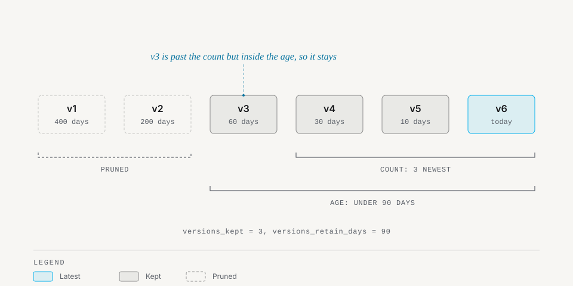

# Versions and retention

## Delete latest policy (`on_delete_latest`)

When soft-deleting the active latest version of a document group, the type's `on_delete_latest` configuration determines the outcome:
- `promote` (default): automatically promotes the highest remaining committed version in the group to become latest, maintaining the latest pointer.
- `none`: clears the latest marker, leaving the group without an active latest document.
- `block`: prevents deletion and throws `MadeByClowd\Documentable\Exceptions\CannotDeleteLatestVersion` if older versions exist in the group.

Configure this on the document type:

```php
'types' => [
    'contract' => [
        'name' => 'Contract',
        'disk' => 's3',
        'requires_versioning' => true,
        'on_delete_latest' => \MadeByClowd\Documentable\Enums\OnDeleteLatest::Promote, // 'promote', 'none', or 'block'
    ],
],
```

When deleting a latest document under the `promote` policy, `DocumentService::delete()` dispatches `MadeByClowd\Documentable\Events\DocumentVersionPromoted`:

```php
$service->delete($latestDocument);
// Next highest committed version is now promoted to is_latest = true
```

## Restoring versions (`restore()`)

Restoring a soft-deleted document brings the record back into active state. It reclaims the latest slot only if no higher version exists and the latest slot is unoccupied; otherwise it restores as an older historical version:

```php
$restored = $service->restore($trashedDocument);
```

## Promoting versions (`promote()`)

To make a specific historical version the latest version of its group, call `promote()`. The current latest version is demoted in the same transaction under a database group lock, and `MadeByClowd\Documentable\Events\DocumentVersionPromoted` is dispatched:

```php
$newLatest = $service->promote($olderDocument);
```

## Deleting a version group (`deleteGroup()`)

To soft-delete all active versions belonging to a group at once without triggering version promotion:

```php
$deletedCount = $service->deleteGroup($document->document_group_id);
```

## Retention policies (`versions_kept` and `versions_retain_days`)

Document types can configure automatic retention rules:
- `versions_kept`: integer count of versions to keep per slot.
- `versions_retain_days`: integer age in days to retain historical versions.

Both axes operate together: a version is pruned only when it exceeds both count and age thresholds. A null axis never prunes on that dimension. If both are null, historical versions are retained indefinitely. The latest version is never pruned by retention.

<p align="center">
  <picture>
    <source media="(prefers-color-scheme: dark)" srcset="images/version-retention-dark.svg">
    
  </picture>
</p>

```php
'types' => [
    'audit-log' => [
        'name' => 'Audit Log',
        'disk' => 's3',
        'requires_versioning' => true,
        'versions_kept' => 10,           // Retain at least 10 versions
        'versions_retain_days' => 30,    // Retain versions up to 30 days old
    ],
],
```

## Retention hold list (`retention.hold`)

To protect specific documents or entire groups from being pruned, add their IDs to `config('documentable.retention.hold')` (`documentable.retention.hold`):

```php
'retention' => [
    'hold' => [
        '9c0a1b2c-3d4e-5f6a-7b8c-9d0e1f2a3b4c', // Specific document ID
        '8b1a2c3d-4e5f-6a7b-8c9d-0e1f2a3b4c5d', // Entire document group ID
    ],
],
```

## Pruning versions (`documents:prune-versions`)

Run the prune command on a schedule to evaluate retention rules and permanently remove expired historical versions:

```bash
# Preview versions eligible for pruning:
php artisan documents:prune-versions --dry-run

# Prune versions for all document types:
php artisan documents:prune-versions

# Prune versions for a specific type:
php artisan documents:prune-versions --type=audit-log
```

Pruning dispatches `MadeByClowd\Documentable\Events\DocumentVersionPruned` for each purged version.
